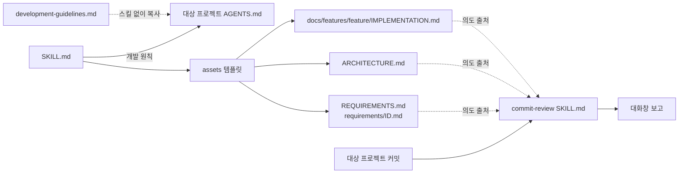

# Architecture

## 한눈에 보기

| 구성 요소 | 역할 | 위치 |
| --- | --- | --- |
| 스킬 진입점 | 개발 원칙, 기존 지침 통합 안내, 문서 초기 설정 절차(FR-01·03) | `skills/toy-project-init/SKILL.md` |
| 커밋 점검 스킬 | 커밋을 하나씩 따라가며 의도 부채·구현 부채 보고(FR-06·07) | `skills/commit-review/SKILL.md` |
| UI 메타데이터 | 스킬별 표시 이름과 기본 프롬프트(FR-05) | `skills/<skill>/agents/openai.yaml` |
| 지침 자산 | 스킬 없이 `AGENTS.md`로 복사할 수 있는 개발 지침(FR-01) | `skills/toy-project-init/assets/development-guidelines.md` |
| 문서 템플릿 | 요구사항 개요·세부, 구조, 구현 문서의 형식(FR-02·03) | `skills/toy-project-init/assets/` |
| 적용 결과 | 이 저장소에 스킬을 적용한 지침·요구사항·구조 문서 | `AGENTS.md`, `REQUIREMENTS.md`, `requirements/`, `ARCHITECTURE.md` |
| 배포 안내 | 설치·사용 안내(FR-05) | `README.md` |
| 개발 기록 | Feature별 구현·검증 기록. Git에서 제외 | `docs/features/` |

외부 시스템·입출력: 공개 저장소 `github.com/CyberFlower/mini-project`. `commit-review`는 대상 프로젝트의 git 이력을 읽는다. git 외의 실행 스크립트와 런타임 의존성은 없다(NFR-01).

## 경계와 결정

| 관심사 | 구성과 이유 |
| --- | --- |
| 실행 방식 | 반복적인 파일 변환이 필요하지 않아 별도 실행 스크립트·생성기를 두지 않는다. 템플릿과 지침으로 문서를 작성한다. |
| 지침 사본 | `SKILL.md`의 개발 원칙, 지침 자산, 루트 `AGENTS.md`는 같은 원칙을 담는다. 템플릿의 상세 형식은 각 템플릿 안내에만 두어 `AGENTS.md`의 크기를 늘리지 않는다. |
| 기존 지침 | 대상 프로젝트의 기존 지침은 보존하고 빠진 부분만 보완한다. |
| 스킬 간 관계 | `commit-review`는 `toy-project-init`이 만든 문서를 의도 출처로 읽기만 하고, 그 스킬을 호출하거나 자산을 공유하지 않는다. 스킬 폴더 하나만 복사해도 쓸 수 있게 하기 위함이다(FR-05). |
| README | 공개 배포를 위한 설치·사용 안내만 둔다. 개발 상태와 설계 설명을 반복하지 않는다. |
| 개발 기록 | `/docs/`는 로컬 개발 기록이라 Git에서 제외한다. 요구사항 원본은 배포되도록 루트에 둔다. |
